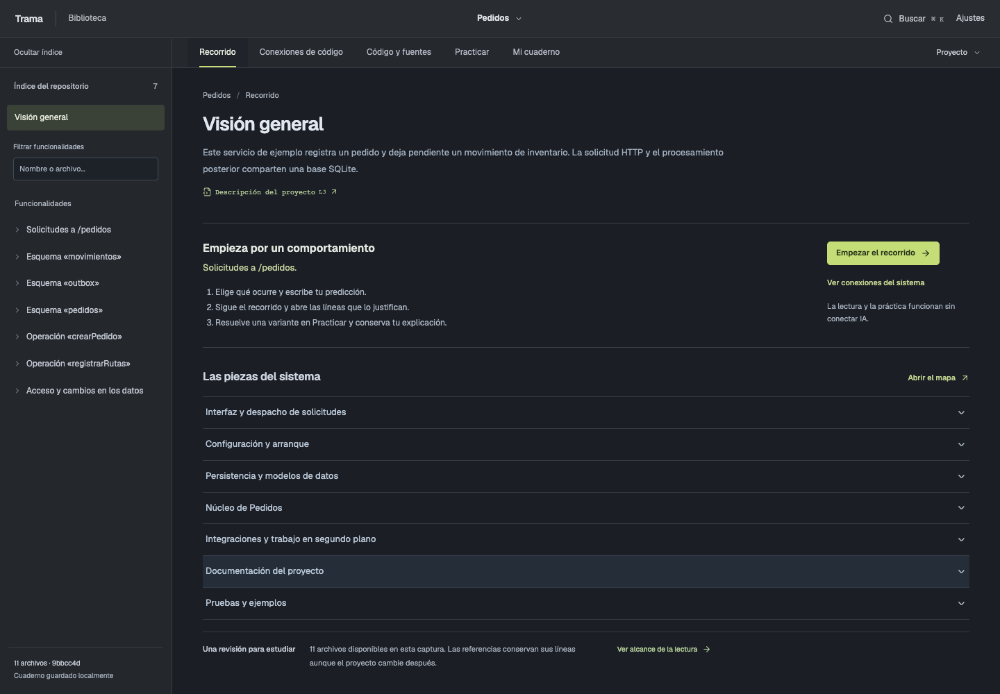
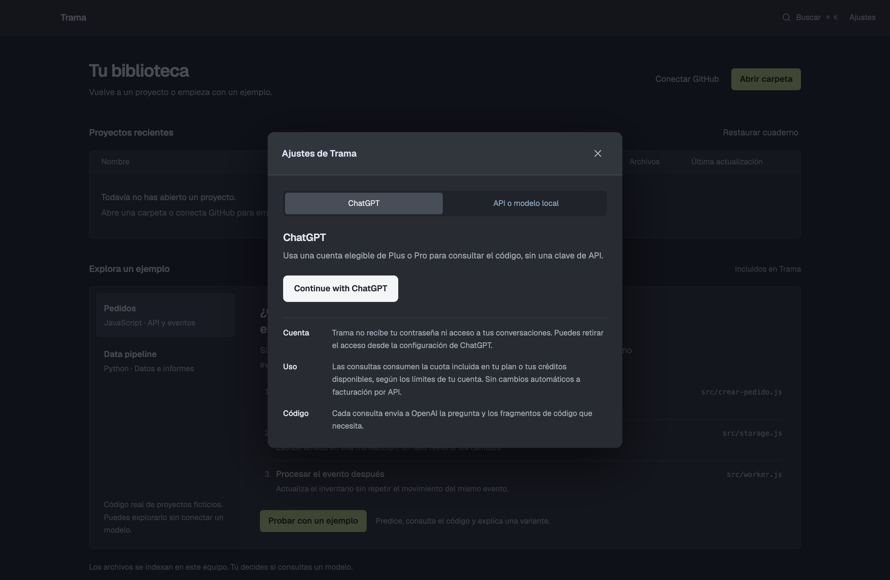
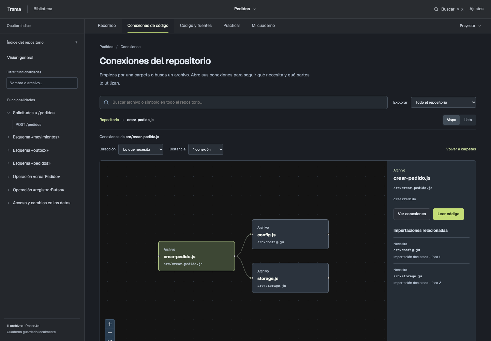

# Trama

[](https://github.com/VillaforTech/trama/actions/workflows/ci.yml) [](LICENSE)

**Un espacio de trabajo para comprender tu código en Mac.**

Trama es una aplicación de escritorio para Mac que convierte un repositorio en un espacio para investigar su arquitectura, seguir un comportamiento entre archivos y practicar cómo explicarlo por tu cuenta. Abre el proyecto con el selector de carpetas de macOS, explora sus conexiones y conserva lo aprendido junto a sus fuentes.

[Probar la demo](https://villafortech.github.io/trama/) · [Instalar en Mac](#instalar-en-mac) · [Empieza aquí](docs/getting-started.md#español-recorrido-de-cinco-minutos) · [English](README.md)



## Empieza aquí

1. Abre un repositorio o elige **Pedidos → Probar con un ejemplo** en la [demo](https://villafortech.github.io/trama/).
2. En **Recorrido**, pulsa **Empezar el recorrido** e investiga un comportamiento. Escribe una predicción y contrástala con la fuente.
3. Usa **Conexiones de código** para recuperar el contexto. Abre una carpeta o las conexiones de un archivo y profundiza por partes.
4. Resuelve una variante en **Practicar** y conserva las dudas en **Mi cuaderno**.

El [recorrido de cinco minutos](docs/getting-started.md#español-recorrido-de-cinco-minutos) propone una primera tarea concreta. La exploración básica funciona sin conectar IA. Trama es una versión preliminar: las agrupaciones y relaciones sugeridas requieren revisión.

## Empieza por una pregunta

Heredas un servicio que registra pedidos y procesa trabajo después. Una respuesta exitosa deja abierta la pregunta de qué ocurre ante un reintento del worker. Abre el ejemplo **Pedidos**, encuentra el manejador de la solicitud y sigue la transacción y el evento pendiente. Antes de revelar el código, escribe si una segunda entrega puede generar otro movimiento y qué evidencia necesitarías para afirmarlo.

El ejemplo **Data pipeline** recorre un CSV, su validación, los descuentos, el filtrado y un informe por región. Puedes rastrear una cantidad hasta las filas que la originan y predecir el efecto de cambiar una regla. Los dos ejemplos contienen datos ficticios y pruebas ejecutables.

## Instalar en Mac

Ejecuta Trama desde el código con **Node.js 24 o posterior**, npm y **macOS 13 o posterior**. La aplicación Mac está comprobada actualmente en Apple Silicon.

```sh
git clone https://github.com/VillaforTech/trama.git
cd trama
npm ci
npm run desktop
```

El comando construye Trama y abre su ventana Mac. Las descargas compiladas están pendientes de publicación. Puedes crear tu propio paquete para Apple Silicon con `npm run dist:mac`; el ZIP y el DMG quedan en `release/`. El empaquetado usa firma ad-hoc, sin identidad Developer ID ni notarización de Apple. [Guía de Apple para abrir aplicaciones descargadas](https://support.apple.com/es-es/102445)

Abre Trama, elige **Abrir carpeta** y selecciona un repositorio clonado. También puedes abrir un repositorio de GitHub o uno de los dos ejemplos incluidos. La exploración y la práctica básicas funcionan sin una cuenta de IA.

| Atajo | Acción                                       |
| ----- | -------------------------------------------- |
| `⌘O`  | Elegir una carpeta con el selector de macOS. |
| `⌘K`  | Abrir la navegación rápida.                  |
| `⌘,`  | Abrir ajustes.                               |

Para GitHub privado puedes usar una sesión autorizada de GitHub CLI o un token con lectura del contenido del repositorio. Con una carpeta local, Trama usa el acceso que ya tienes a sus archivos. Si usas GitHub CLI, inicia sesión con `gh auth login` antes de importar. El token queda fuera de las investigaciones guardadas.

La [vista previa del navegador](https://villafortech.github.io/trama/) contiene ejemplos ficticios para conocer el recorrido. Para conectar ChatGPT o importar un repositorio privado necesitas la aplicación local. También puedes usar la interfaz local del navegador con `npm run build` y luego `npm start`, en `http://127.0.0.1:4891`.

## Qué puedes hacer

- **Explorar el conjunto.** Ir desde una arquitectura y funcionalidades sugeridas hasta un proceso con archivos y líneas concretas.
- **Seguir conexiones.** Ir de grupos de carpetas a archivos, acotar sus dependencias y abrir la evidencia de una relación. Usar una lista cuando resulte más legible que el lienzo.
- **Buscar en la captura.** Encontrar símbolos y texto entre los archivos indexados.
- **Practicar razonamiento.** Escribir una predicción, contrastarla con la fuente, explicar una diferencia y resolver una variante. Conservar una autoevaluación de cada intento.
- **Consultar con fuentes.** Conectar ChatGPT o configurar un modelo local o compatible con OpenAI. Sus referencias se comprueban contra el código capturado.
- **Retomar el trabajo.** Guardar notas y posición, volver a una revisión, comparar archivos cambiados y exportar o restaurar una investigación.

## Conectar ChatGPT

En la aplicación Mac, abre **Ajustes** y elige **Continue with ChatGPT**. Completa el inicio de sesión en tu navegador, autoriza el uso de tu plan y selecciona un modelo disponible. Trama recibe su propia conexión autorizada; no necesitas una API key ni instalar Codex. El modo de navegador local admite API y Ollama; la conexión ChatGPT necesita el almacenamiento seguro de la aplicación Mac.



Las cuentas **ChatGPT Plus y Pro elegibles** pueden usar la capacidad incluida en su plan o los créditos disponibles para solicitudes admitidas. OpenAI determina la disponibilidad y los límites. Esta integración corresponde a la aplicación abierta de Trama que ejecutas localmente. [Guía oficial de integración](https://developers.openai.com/cookbook/articles/sign-in-with-chatgpt)

El inicio de sesión no da acceso a tu historial de conversaciones de ChatGPT. Cuando solicitas una explicación, Trama envía la pregunta y los fragmentos seleccionados directamente a OpenAI. Consulta el consumo, los créditos y los accesos en [Ajustes de uso de ChatGPT](https://chatgpt.com/settings/usage). Si se agota la cuota o falla la autorización, la solicitud se detiene sin cambiar automáticamente a facturación por API.

El conector es preliminar. La comprobación con una cuenta real, los modelos autorizados y el consumo efectivo del plan siguen pendientes. La aplicación Mac cifra sus credenciales de ChatGPT mediante el almacenamiento seguro del sistema. Las capturas de código y los cuadernos permanecen sin cifrar. La [política de seguridad](SECURITY.md) describe estos límites y qué información sale del equipo.

### Avanzado: API u Ollama

En **Ajustes**, configura la dirección base de una API compatible con OpenAI y un modelo disponible en ese servidor. Para una instalación existente de Ollama, usa `http://127.0.0.1:11434/v1`. Trama requiere que el modelo ya esté instalado y disponible. Comprueba la conexión antes de consultar.

API y Ollama son opciones independientes de la conexión de ChatGPT. Una API externa usa la facturación de la cuenta del proveedor configurado. Cada consulta externa requiere autorización para enviar los fragmentos seleccionados. La API debe implementar `/chat/completions` y responder con la estructura JSON solicitada.

Las API keys introducidas en la interfaz permanecen en la memoria del servicio. La dirección y el nombre del modelo se conservan localmente. Estas variables configuran la conexión por API:

| Variable               | Uso                                                                                                                                  |
| ---------------------- | ------------------------------------------------------------------------------------------------------------------------------------ |
| `TRAMA_DATA_DIR`       | Cambiar el directorio del modo navegador local, inicialmente `~/.trama`. La aplicación Mac usa su directorio de Application Support. |
| `TRAMA_MODEL_ENDPOINT` | Dirección base de la API del modelo.                                                                                                 |
| `TRAMA_MODEL`          | Identificador del modelo.                                                                                                            |
| `TRAMA_MODEL_API_KEY`  | Credencial del proveedor desde el entorno.                                                                                           |

## Explorar un repositorio grande

El mapa comienza con una vista organizada por carpetas. Entra en la parte relevante, busca un archivo o símbolo y revisa sus dependencias y los archivos que dependen de él. Puedes acotar la vista y seguir las relaciones progresivamente. Cada proyección informa sus límites y resultados omitidos; la captura conserva más información que la que cabe en el lienzo.

Es un grafo estructural guardado con la captura local en SQLite. Agrupar carpetas describe la ubicación de los archivos, sin certificar límites de arquitectura. Cambiar a una base de grafos no resolvería por sí solo la saturación visual. La implementación actual prioriza vistas acotadas y evidencia localizable. [Investigación y decisiones sobre grafos](docs/research.md#graphs-for-large-codebases)



## Fuentes y alcance

Una referencia comprueba dónde está el fragmento citado. Determinar si sostiene la explicación requiere revisarlo. Trama muestra declaraciones visibles, relaciones inferidas y cuestiones abiertas. El mapa representa conexiones estructurales. Una traza de ejecución aporta otro tipo de evidencia.

La ruta inicial se construye mediante heurísticas de análisis del código: agrupa declaraciones, importaciones, puntos de entrada y documentación para proponer un orden de lectura. Las consultas opcionales a un modelo son otra capacidad. Importar un repositorio todavía requiere revisar las propuestas y completar lo que el análisis no puede establecer.

El análisis admite hasta 4000 archivos locales o 500 de GitHub, con 32 MB de texto y 512 KB por archivo. Muestra la cobertura incompleta y permite excluir archivos adicionales mediante `.tramaignore`. Las importaciones JavaScript y TypeScript se analizan mediante su sintaxis. Las relaciones Python se presentan como candidatas. El despacho dinámico, las configuraciones de ejecución, los servicios externos y el código generado pueden requerir fuentes adicionales.

Las revisiones de los ejercicios son autoevaluaciones. Esta versión todavía requiere una evaluación controlada de su efecto sobre el aprendizaje de software. Las [notas de investigación](docs/research.md) explican la evidencia educativa y proponen una comparación con un editor y un asistente.

## Código privado

La aplicación de escritorio ejecuta el servicio de indexación en tu Mac y conserva las fuentes y el aprendizaje en `~/Library/Application Support/Trama/data` mediante SQLite. La lectura de una carpeta construye la captura sin ejecutar el proyecto importado. Una consulta opcional a un modelo envía el contexto seleccionado al proveedor configurado. El modo de navegador local usa inicialmente `~/.trama`.

La captura y los archivos JSON exportados pueden contener código privado. Trama los guarda sin cifrado propio. Consulta el [flujo de datos y la política de seguridad](SECURITY.md) antes de usar un repositorio de tu organización. El repositorio público y la demo contienen ejemplos ficticios.

## Contribuir

```sh
npm ci
npm run desktop
npm run check
npm test
npm run build
```

Para desarrollar la interfaz con recarga automática, ejecuta `npm run dev` y abre `http://127.0.0.1:5173`. La API usa el puerto 4891. Para las pruebas del navegador, instala Chromium con `npx playwright install chromium` y ejecuta `npm run test:e2e`. La ventana Mac, el selector nativo, los menús y el inicio del paquete requieren comprobación adicional en la aplicación.

Puedes contribuir con una mejora del recorrido, una inferencia incorrecta reproducible o una tarea de aprendizaje más clara. Consulta la [guía de contribución](CONTRIBUTING.md), la [arquitectura](docs/architecture.md) y el [roadmap](docs/roadmap.md).

Las comprobaciones y sus límites están en [verificación de la versión](docs/verification.md). Para preguntas o reportes, consulta [soporte](SUPPORT.md) y las [normas de la comunidad](CODE_OF_CONDUCT.md).

## Referencias y licencia

LearnHarness sirvió como referencia conceptual para distinguir comprensión inicial, enseñanza mediante predicción y práctica independiente. Trama tiene implementación, instrucciones de modelos, ejemplos e identidad visual propios. [LearnHarness](https://github.com/amosblomqvist/learnharness)

El código original y los ejemplos usan la [licencia MIT](LICENSE). Las dependencias y los recursos de terceros conservan sus licencias. Consulta [NOTICE](NOTICE).
