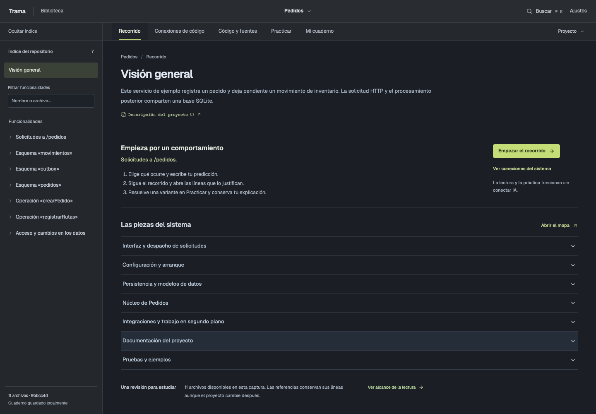
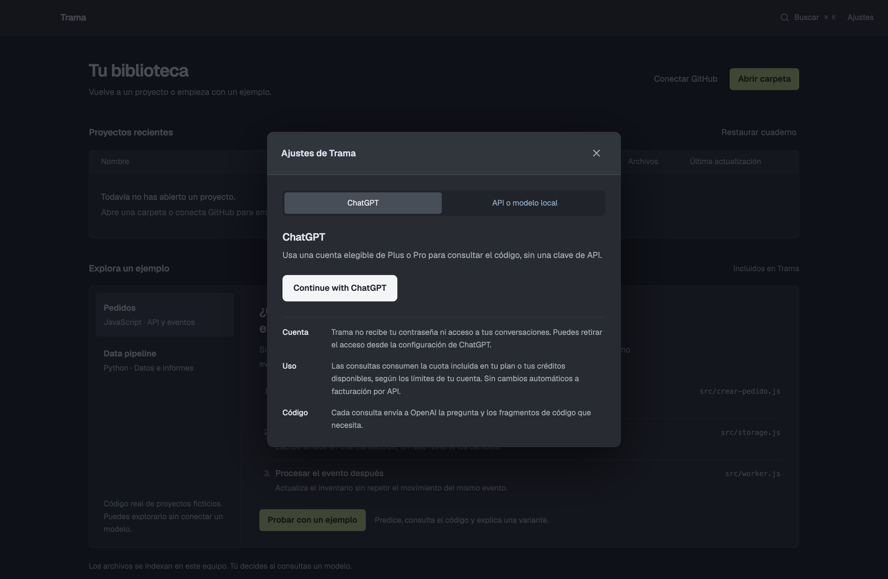
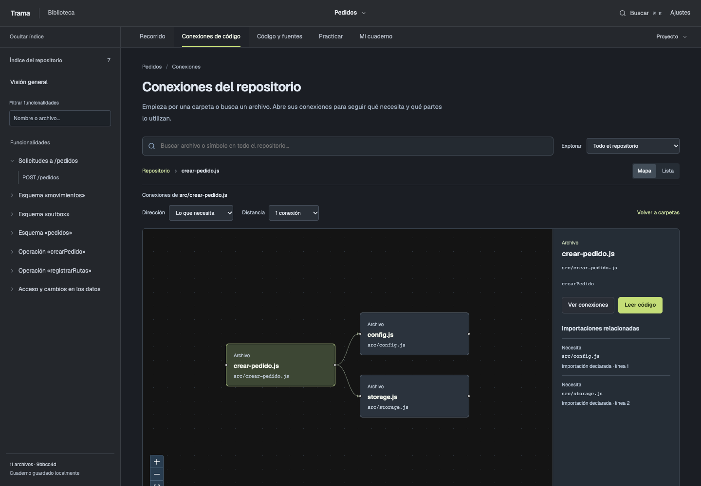

# Trama

[](https://github.com/VillaforTech/trama/actions/workflows/ci.yml) [](LICENSE)

**A Mac workspace for understanding your code.**

Trama is a desktop application for Mac that turns a repository into a place to investigate architecture, follow a behavior across files, and practice explaining it yourself. Open a project with the native folder picker, explore its connections, and keep a source-backed record of what you understand.

[Try the demo](https://villafortech.github.io/trama/) · [Install on Mac](#install-on-mac) · [Start here](docs/getting-started.md) · [Español](README.es.md)



## Start here

1. Open a repository or choose **Pedidos → Probar con un ejemplo** in the [demo](https://villafortech.github.io/trama/).
2. In **Recorrido**, choose **Empezar el recorrido** and investigate one behavior. Write a prediction, then inspect the cited code.
3. Use **Conexiones de código** to recover context. Open a folder or a file's neighborhood rather than trying to read the entire map at once.
4. Try a changed case in **Practicar** and keep unresolved questions in **Mi cuaderno**.

Follow the [five-minute walkthrough](docs/getting-started.md) for a concrete first task. Basic exploration works without an AI account. Trama is an early preview; the interface uses Spanish, and inferred architecture still needs review.

## Start with a question

You inherit a service that creates orders and processes work later. A successful response tells you little about what happens if the worker retries. Open the **Pedidos** example, find the request handler, follow the transaction and pending event, then explain whether another delivery can create another movement. Write a prediction before revealing the relevant code. Return later to practice a changed scenario.

The included **Data pipeline** example follows a CSV through validation, discounts, filtering, and regional aggregation. It lets you trace a reported amount back to its input rows and predict how a rule change affects the report. Both examples contain runnable tests and fictional data.

## Install on Mac

Run Trama from source with **Node.js 24 or newer**, npm, and **macOS 13 or later**. The Mac application is currently tested on Apple Silicon.

```sh
git clone https://github.com/VillaforTech/trama.git
cd trama
npm ci
npm run desktop
```

The command builds Trama and opens its Mac window. Prebuilt downloads are pending publication. You can build an Apple Silicon package yourself with `npm run dist:mac`; it creates a ZIP and DMG in `release/`. Packaging uses an ad-hoc signature and has no Apple Developer ID identity or notarization. [Apple's guidance for downloaded applications](https://support.apple.com/en-us/102445)

Open Trama, choose **Abrir carpeta**, and select a local checkout. A GitHub repository and two included examples are also available. The interface currently uses Spanish. The core exploration and practice flow works without an AI account.

| Shortcut | Action                                         |
| -------- | ---------------------------------------------- |
| `⌘O`     | Open a repository folder using the Mac picker. |
| `⌘K`     | Open quick navigation.                         |
| `⌘,`     | Open settings.                                 |

For a private GitHub repository, use an authorized GitHub CLI session or supply a token with read access to that repository. A local checkout uses the access you already have to its files. If you use GitHub CLI, sign in with `gh auth login` before importing. Tokens remain outside saved investigations.

The [browser preview](https://villafortech.github.io/trama/) contains fictional examples for a quick look at the workflow. ChatGPT sign-in and private repository import require the local application. A local browser interface is also available with `npm run build` followed by `npm start` at `http://127.0.0.1:4891`.

## What you can do

- **Explore the system.** Start with suggested architecture and functionality, then open a process with file and line references.
- **Follow relationships.** Move from folder groups to files, inspect a bounded dependency neighborhood, and open the evidence behind a connection. Use a list when it is easier to read than the canvas.
- **Search the capture.** Find symbols and text across the indexed files without losing your investigation.
- **Practice reasoning.** Record a prediction, reveal evidence, explain a mismatch, and try a transfer question. Review attempts later with an explicit self-assessment.
- **Ask a source-backed question.** Connect ChatGPT, or configure an optional local or OpenAI-compatible model. Replies include references that are checked against the captured source.
- **Keep your work.** Save notes and progress, revisit captured revisions, compare file changes, and export or restore an investigation.

## Connect ChatGPT

In the Mac application, open **Ajustes** and choose **Continue with ChatGPT**. Complete sign-in in your browser, approve ChatGPT plan usage, then choose an available model. This connects Trama separately from other applications signed into your account; it does not require an API key or Codex installation. The local browser mode supports API and Ollama connections; ChatGPT sign-in requires the Mac app's secure storage.



Eligible **ChatGPT Plus and Pro** accounts can authorize eligible requests using their plan allowance or available credits. OpenAI determines availability and limits. This integration targets Trama's open-source, locally running application. [OpenAI's integration guide](https://developers.openai.com/cookbook/articles/sign-in-with-chatgpt)

Sign-in does not grant access to your ChatGPT conversation history. Trama sends the question and selected source excerpts directly to OpenAI when you request an explanation. Review your allowance, credits, and access in [ChatGPT usage settings](https://chatgpt.com/settings/usage). A quota or authorization error stops the request; Trama does not silently switch to API-key billing.

The connector is a preview. Validation with a real account, live model eligibility, and actual allowance consumption is still pending. The Mac app encrypts its saved ChatGPT credentials through the system's secure storage. Source captures and notebooks remain unencrypted. The [security policy](SECURITY.md) explains these boundaries and external processing.

### Advanced: API or Ollama

In **Ajustes**, configure an OpenAI-compatible API base URL and a model available on that server. For an existing Ollama installation, use `http://127.0.0.1:11434/v1`. Trama does not install or download models. Test the connection before asking a question.

API and Ollama connections are separate choices from ChatGPT sign-in. External API billing belongs to the provider account you configure. Each external model request requires consent to send its selected source context. Compatible endpoints must implement `/chat/completions` and return the requested JSON structure.

API keys entered in the interface remain in service memory. Endpoint and model preferences persist locally. The following environment variables configure this API route:

| Variable               | Purpose                                                                                                                           |
| ---------------------- | --------------------------------------------------------------------------------------------------------------------------------- |
| `TRAMA_DATA_DIR`       | Change the data directory in local browser mode, whose default is `~/.trama`. The Mac app uses its Application Support directory. |
| `TRAMA_MODEL_ENDPOINT` | Set the OpenAI-compatible API base URL.                                                                                           |
| `TRAMA_MODEL`          | Set the model identifier.                                                                                                         |
| `TRAMA_MODEL_API_KEY`  | Supply the model credential through the environment.                                                                              |

## Explore a large repository

The map begins with an organizational overview. Open the relevant folder, search for a file or symbol, then inspect the selected file's dependencies and dependents. You can change the scope and follow connections progressively. Each visible projection reports its limits and omitted results; the source snapshot is not reduced to what fits on the canvas.

This is a structural source graph stored with the local SQLite snapshot. Folder grouping describes where files live; it does not certify architectural boundaries. Replacing SQLite with a graph database would not by itself make a crowded diagram understandable. The current implementation prioritizes bounded views and source evidence. [Graph research and decisions](docs/research.md#graphs-for-large-codebases)



## Evidence and scope

A reference proves where a statement points. Whether that source actually supports the explanation still requires judgment. Trama labels source declarations, inferred relationships, and unresolved claims. Its map shows structural connections rather than a recorded execution trace.

The initial learning route comes from source-analysis heuristics. It groups visible declarations, imports, entry points, and documentation into a proposed reading order. Optional model questions are a separate capability; importing a repository does not produce a complete, independently verified architecture.

Local indexing is bounded to 4,000 files and GitHub indexing to 500 files, with 32 MB of text and 512 KB per file. It reports incomplete coverage. Use `.tramaignore` to exclude additional files. TypeScript and JavaScript imports receive syntax-based analysis. Python import links are candidates. Dynamic dispatch, runtime configuration, external services, and generated code may need additional evidence. Inspect the shown sources before relying on a suggested path.

Practice reviews are self-assessments. This release has not been evaluated in a controlled study of software learning. The [research notes](docs/research.md) describe the rationale and a proposed comparison with an editor plus an assistant.

## Private repositories

The desktop application runs its indexing service on your Mac and stores its source captures and learning records in `~/Library/Application Support/Trama/data` using SQLite. Reading a checkout does not execute the imported project's code. An optional model request sends the selected context to the provider you configured. The local browser mode uses `~/.trama` by default.

Captured source and exported JSON files can contain private code. Trama's local database and exports are unencrypted. See the [data flow and security policy](SECURITY.md) before using an organizational repository. The public source repository and browser demo contain fictional examples.

## Development

```sh
npm ci
npm run desktop
npm run check
npm test
npm run build
```

For interface development, `npm run dev` serves the React interface on `http://127.0.0.1:5173` and proxies its API to port 4891. Browser checks use Playwright. The desktop shell, native picker, packaged startup, and Mac menus require checks in the Mac application as well.

```sh
npx playwright install chromium
npm run test:e2e
```

Contributions that improve a source trace, fix a misleading inference, or make a learning task easier to complete are welcome. See [contributing](CONTRIBUTING.md), [architecture](docs/architecture.md), and the [roadmap](docs/roadmap.md).

Engineering checks and their limits are recorded in [release verification](docs/verification.md). For questions or reports, see [support](SUPPORT.md) and the [community conduct](CODE_OF_CONDUCT.md).

## Acknowledgements and license

LearnHarness informed the distinction between measuring understanding, teaching with prediction, and practicing independently. Its source was reviewed as a design reference. Trama's implementation, prompts, examples, and visual identity were created independently. [LearnHarness](https://github.com/amosblomqvist/learnharness)

Trama's original code and examples are available under the [MIT license](LICENSE). Third-party assets and dependencies retain their own licenses. See [NOTICE](NOTICE).
