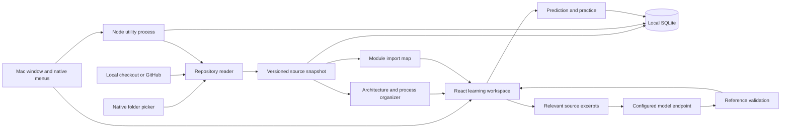

# Architecture

Trama is a Mac application built with Electron 45. Its main process owns the window, Mac menus, and native folder selection. A separate utility process runs the Node.js indexing service and SQLite storage. The React renderer provides the learning workspace. An optional model connection explains selected source excerpts. Electron 45 supports macOS Ventura 13 and later. [Electron platform support](https://github.com/electron/electron/blob/v45.0.0/README.md#platform-support)

## Components

| Component         | Responsibility                                                                             | Entry point                               |
| ----------------- | ------------------------------------------------------------------------------------------ | ----------------------------------------- |
| Mac shell         | Native window, picker, menus, process lifecycle, restricted preload bridge                 | `desktop/main.cjs`, `desktop/preload.cjs` |
| Interface         | Project navigation, maps, source inspection, practice, notes, settings                     | `src/main.tsx`                            |
| API boundary      | Local request checks, import jobs, snapshot and notebook operations                        | `server/index.ts`                         |
| Repository reader | Enumerate allowed files, read content, record coverage and revision                        | `server/repository.ts`                    |
| Organizer         | Identify declarations and propose architecture, functionalities, and process reading steps | `server/organizer.js`                     |
| Module graph      | Resolve visible local JS/TS import relationships and Python candidates                     | `server/graph.ts`                         |
| Persistence       | Projects, snapshots, source files, versioned learning records                              | `server/database.ts`                      |
| Learning          | Retrieve context, build exercises, validate model source references                        | `server/learning.ts`                      |
| Model connection  | Endpoint configuration, consent, bounded requests, timeout and error handling              | `server/provider.ts`                      |
| Shared contracts  | Data structures for snapshots, references, learning and models                             | `shared/`                                 |

## Snapshot and learning model

A project identifies a repository location. A snapshot captures the indexed text at a revision. Each file records a relative path, text, size, and content hash. A reference carries a path, starting and ending line, and the exact excerpt. The generated plan and the import map are derived from that same capture.

Learning belongs to a snapshot. It stores the current view and process, notes, predictions, use of a hint, reflection, review attempts, and model-assisted questions. Updates include the version read by the client. A stale update returns a conflict so another window's work can be recovered before saving.

Snapshots preserve the evidence for old explanations. Refreshing a project creates or reuses the matching capture. Comparing captures reports changed, added, and removed source files. A changed file identifies work to revisit. Determining whether its change invalidates an explanation is a further reasoning task.

SQLite transactions keep source and metadata writes consistent. The database uses WAL and foreign-key constraints. In the Mac app, source content and progress are stored in `~/Library/Application Support/Trama/data/trama.sqlite`. The optional local browser mode uses `~/.trama/trama.sqlite`, or a directory selected through `TRAMA_DATA_DIR`. JSON export includes the source needed to reopen an investigation. Restoration validates references before accepting a bundle.

## Import and structural analysis

Local imports read the selected directory and apply ignore rules and explicit exclusions. Repository code is read as text. Dependencies and project hooks are not executed. GitHub imports request repository data through the API using the chosen authorization context. The importer fixes a revision before fetching its source.

The organizer uses deterministic heuristics to recognize source declarations, routes, commands, manifests, and documentation. It proposes groups and reading steps with references. Importing a repository does not call a model to reconstruct its complete architecture. JavaScript and TypeScript module relationships use the TypeScript parser. Python import relationships use conservative text matching and are identified as candidates. A syntax edge establishes a written dependency. Configuration, dispatch, and external execution determine whether that edge is used at runtime.

Local indexing accepts up to 4,000 files, 32 MB of source text, and 512 KB per file. GitHub indexing accepts up to 500 files with the same text and per-file budgets. `.gitignore` and `.tramaignore` rules can exclude source content. Common generated directories, credential filenames, symbolic links, binaries, and detected credential patterns are skipped. The UI exposes truncated trees and incomplete coverage. Larger repositories can require a narrower import or future incremental indexing work.

## Model-assisted questions

The learning service retrieves source windows using the question and the selected process. It sends at most 30,000 bytes of excerpt context from at most 12 source files. Lines retain their original numbers. Files are treated as untrusted content within the model request.

The model returns a structured answer with a summary, claims, references, an optional example, and a next question. The validator checks that cited ranges were actually present in the request and exist in the captured files. It reconstructs the displayed excerpt from the snapshot. Missing or invalid references cannot become verified source evidence. A correct line range still does not prove the semantic claim attached to it.

The default endpoint is a local OpenAI-compatible server. External endpoints use HTTPS and require explicit consent for each request. Provider credentials remain in server memory or the process environment. Endpoint and model names persist in `provider.json`. A request has a timeout, response size limit, and a concurrency limit. Redirects are rejected.

## Mac process boundary

The main process creates the application window and starts the service through Electron's `utilityProcess`. That process uses Electron's embedded Node.js runtime, so the packaged application can index repositories and use `node:sqlite` without a separate Node installation. The service binds to a random loopback port. An ephemeral API credential is generated for each application launch. The renderer reaches the local API through the application-owned session.

The preload bridge exposes specific desktop operations. Folder selection uses the native macOS dialog. Menu shortcuts open a folder with `⌘O`, quick navigation with `⌘K`, settings with `⌘,`, and the library with `⌘L`. Standard Mac window and application shortcuts remain available.

The renderer has context isolation enabled and Node integration disabled. Main-process handlers validate the sending frame and restrict external navigation. Repository files and model answers are displayed as content. Access to the filesystem belongs to the application service and the narrow native bridge. [Electron security guidance](https://www.electronjs.org/docs/latest/tutorial/security) · [Utility process API](https://www.electronjs.org/docs/latest/api/utility-process)

## Build and distribution

`npm run desktop` builds the interface and service, then starts the Mac application. `npm run dist:mac` creates the configured Apple Silicon release artifacts in `release/`. The first distributed Mac build requires macOS 13 or newer. Intel packages, other desktop platforms, and automatic updates require their own packaging and validation work.

The first preview has no Apple Developer ID certificate or notarization. Approval on a downloaded build is handled by macOS. An ad-hoc signature can establish the package's structural signature, while Developer ID and notarization require the maintainer's Apple credentials. Release notes report the signature status of the actual artifact. [Electron signing and notarization](https://www.electronjs.org/docs/latest/tutorial/code-signing)

The optional local browser mode uses `npm run build` and `npm start`, serving the application at port 4891. Interface development uses Vite on port 5173 with an API proxy. These modes support interface and backend development alongside native Mac testing.

GitHub Actions checks the application on Linux and macOS and runs the desktop shell test on macOS. The manual **Build Mac artifacts** workflow uses an Apple Silicon macOS 15 runner, installs the lockfile, builds the ZIP and DMG, and tests the packaged executable before uploading archives and SHA-256 checksums as workflow artifacts. It does not create a GitHub release, sign with Developer ID, or notarize the application. A successful CI run verifies that specific revision and runner; testing on the minimum supported macOS version and a downloaded fresh-machine installation remains a separate release check.

The public browser preview is a static build containing fictional projects. It uses a separate adapter for bundled snapshots and stores demonstration progress in that browser. The static preview has no access to the visitor's Mac service or private repositories.

Shared hosting, organization-wide access control, GitHub App installations, and encrypted synchronization require additional implementation. See the [roadmap](roadmap.md).
